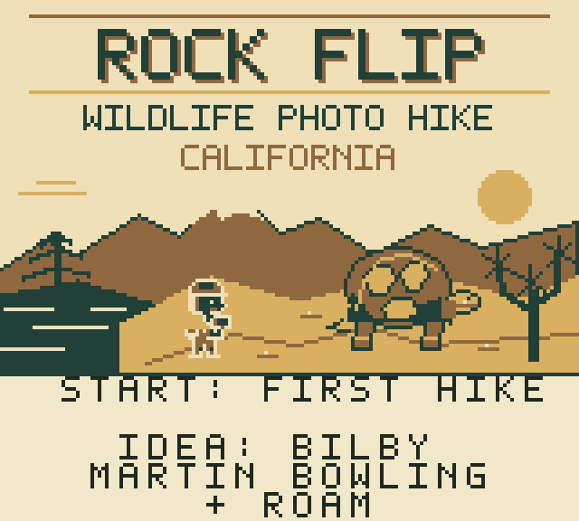

# Rock Flip

An original Game Boy Color wildlife-photography adventure across California.
Hike deserts, mountains, forests, wetlands, coasts and islands; read habitat
clues, take respectful photographs and build a statewide exhibit.

**150 regular native species + one hidden discovery · 16 districts · 241 screens**

## Play

Download the `.gbc` cartridge from [Releases](https://github.com/martinbowling/rockflip/releases/tag/v0.9.2),
or use [the included v0.9.2 ROM](dist/RockFlip-v0.9.2.gbc). Play in a compatible
Game Boy Color emulator or install on a compatible homebrew cartridge.

| Button | Action |
|---|---|
| D-pad | Walk; frame and adjust distance in the camera |
| A | Observe/peek/lift a permitted loose stone; open camera; shutter |
| B | Back out; replace opened cover carefully |
| Start | Start/Continue; field pack or nearby ranger camp |
| Select | Field Guide; contextual options in other screens |

Rest at camps to choose time, weather and season. There are no real-calendar
waits. You collect photographs, never animals. No catching, combat, handling,
baiting or borrowed franchise artwork/UI/audio.

The campaign includes 16 regional investigations, 48 stages, 32 optional photo
tasks, four chapter conclusions, a growing exhibit, an ending and continued
exploration. Individual animals have varied natural movement and hiding behavior.
Your journal and best-photo composition persist in battery SRAM.

## Build and contribute

- [Build instructions](docs/BUILD.md)
- [Current validation and remaining review](docs/QA.md)
- [Development handoff](HANDOFF.md)
- [Roadmap](TODO.md)
- [License scope and upstream notices](THIRD_PARTY_NOTICES.md)

Open `native/project.gbsproj` in the ModRetro Chromatic plugin/GB Studio workflow.
Editable pixel sources live in `art/src/`; regenerate with
`python native/tools/production_generate.py`. Import the 1x assets, never 4x previews.
Reviewed identities, broad habitat permissions and original facts live in `data/`.
No real-world wildlife coordinates are included.

## Release status

v0.9.2 is a substantial statewide **development release**, with a complete
new-game-to-finale path and all 151 species tested in the native cartridge.
All 31 native suites pass on the shipped ROM. Human fun/pacing, listening,
handheld readability and physical cartridge testing remain open; playtime
targets are not measured hours. See docs/QA.md for exact evidence and limits.

## Credits

Game: **Martin Bowling + Roam**. Idea: **Bilby**
([@theslickapache](https://x.com/theslickapache)).
Original pixel art, gameplay, field-note text and sound motifs are included with
their editable sources. GB Studio, GBVM, GBDK/SDCC and licensed starter components
retain their notices. Public source availability does not add a blanket license
for every original asset; see LICENSE and THIRD_PARTY_NOTICES.md.
